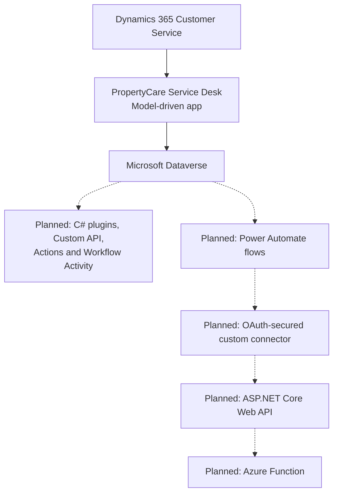

# PropertyCare CRM

**Dynamics 365 Customer Service | Dataverse | Power Platform | .NET**

PropertyCare CRM is a residential maintenance management solution built on Microsoft Dynamics 365 Customer Service and Microsoft Dataverse. It supports maintenance operations from case intake through resolution, with a roadmap covering business processes, server-side extensions, workflow automation, and external .NET integrations.

> **Project status:** In development  
> **Current foundation:** Dataverse data model and initial model-driven application configuration  
> **Application:** PropertyCare Service Desk

## Tech Stack

| Category | Technologies |
| --- | --- |
| CRM | Microsoft Dynamics 365 Customer Service |
| Low-code platform | Power Apps, Power Automate |
| Data platform | Microsoft Dataverse |
| External backend | C#, .NET 10, ASP.NET Core Web API |
| Dataverse extensibility | Plugins, Custom APIs, Custom Workflow Activities |
| Client-side development | JavaScript, TypeScript, Power Apps Component Framework (PCF) |
| Cloud services | Azure Functions |
| Integration | REST APIs, OAuth 2.0, custom connectors |
| Application lifecycle management | Power Platform Solutions |

The stack describes the project's current foundation and intended implementation. Advanced extensions and external services remain planned unless explicitly documented as delivered in a release. The .NET version above applies to the external backend; Dataverse extensions must use their supported runtime and SDK requirements.

## Core Features

The project scope covers:

- **Maintenance case management:** Track residential maintenance requests, priorities, response targets, and resolution details.
- **Property and resident management:** Associate properties, units, tenancies, and residents with service cases.
- **Visit scheduling:** Manage maintenance visits, vendors, schedules, and outcomes.
- **Cost approval management:** Record estimated costs and approval decisions.
- **Response monitoring:** Support priority-based response targets and escalation workflows.
- **Security:** Apply role-based access and column-level protection for sensitive information.

See [Development Status](#development-status) for implementation boundaries.

## Dataverse Data Model

The documented foundation introduces five custom Dataverse tables:

| Table | Purpose |
| --- | --- |
| Property | Stores residential properties and management information |
| Unit | Represents individual units belonging to properties |
| Tenancy | Associates residents with units and tenancy periods |
| Visit | Tracks maintenance visits associated with cases |
| Cost Approval | Records cost approval requests and decisions |

The solution also extends the standard **Case (Incident)** table with 15 custom columns and integrates with standard **Account** and **Contact** records.

**Documented data model scope:**

- 5 custom tables
- 15 custom Case columns
- 11 custom lookup relationships
- 3 alternate keys
- 4 global choices

These figures describe the project baseline. Confirm the components included in the specific solution version you import.

## Architecture

The architecture separates CRM configuration, Dataverse business logic, workflow orchestration, and external service integration. Dashed connections represent planned extensions and integrations.

## Installation & Setup (Unmanaged Solution)

Use these steps to import the available PropertyCare CRM customizations into your own development environment.

> **Development use:** An unmanaged solution is editable source configuration for development. Use a managed solution and a validated deployment process for downstream test and production environments. See Microsoft's [solution lifecycle guidance](https://learn.microsoft.com/en-us/power-platform/alm/solution-concepts-alm).

### 1. Obtain the Latest Unmanaged Solution ZIP

Download the **latest unmanaged solution ZIP uploaded by the project maintainer**. Use the maintainer's release notes and solution version to identify the intended package; do not substitute GitHub's **Download ZIP** source-code archive.

The exact uploaded ZIP filename and version have not been verified for this README. Use the actual uploaded artifact without renaming or repackaging it, and confirm its solution name, publisher, version, and unmanaged type during import.

### 2. Create a Power Platform Environment with Dataverse

1. Sign in to the [Power Platform admin center](https://admin.powerplatform.microsoft.com/) with an account permitted to create environments.
2. Go to **Manage > Environments > New** and create a dedicated development sandbox with an appropriate name and region.
3. Set **Add a Dataverse data store** to **Yes** and complete the database settings.
4. Because PropertyCare uses Dynamics 365 Customer Service and the standard Case table, provision the environment with **Enable Dynamics 365 apps = Yes** and install **Dynamics 365 Customer Service** with the required entitlement. This choice must be made when the database is created; it cannot be enabled later for that database.
5. Wait until the environment, Dataverse database, and required Dynamics 365 applications are ready.

You need suitable licensing or trial entitlements, tenant capacity, and environment access. A Dataverse-only environment is not sufficient if the package depends on Customer Service components. Follow Microsoft's [environment creation guidance](https://learn.microsoft.com/en-us/power-platform/admin/create-environment).

### 3. Import the Solution and Resolve Dependencies

1. Open [Power Apps](https://make.powerapps.com/) and select the target environment.
2. Go to **Solutions > Import solution**. If necessary, find **Solutions** under **More**.
3. Select **This device > Browse**, choose the latest uploaded unmanaged solution ZIP, and select **Next**.
4. Verify the displayed solution identity, version, publisher, and unmanaged type.
5. Resolve every reported dependency by installing the required application or prerequisite solution/version. Request a corrected export if required project components are missing.
6. Complete any connection or environment-variable prompts described below, then select **Import**.
7. Confirm success in solution history. If import fails, download the log and resolve the reported cause before retrying.

The importing account needs privileges to create all packaged component types; **System Administrator** includes the privilege required for plugin assemblies. See Microsoft's [solution import instructions](https://learn.microsoft.com/en-us/power-apps/maker/data-platform/import-update-export-solutions).

### 4. Configure Connections and Environment Variables, If Present

These steps apply only when the imported version includes the relevant components. Their presence is not assumed for the current foundation.

- **Connection references:** Map each reference to a valid connection in the target environment. Create or authenticate connections with the intended account, then review bindings in the imported solution. Connection references do not transfer usable source-environment credentials. See [connection reference guidance](https://learn.microsoft.com/en-us/power-apps/maker/data-platform/create-connection-reference).
- **Environment variables:** Supply target-specific values for the definitions actually included. Review existing defaults and current values even if import does not prompt you. No project-specific variable names or values are assumed here. See [environment variable guidance](https://learn.microsoft.com/en-us/power-apps/maker/data-platform/environmentvariables).
- **Cloud flows, if included:** Review ownership, connections, configuration, and activation state before testing. The account enabling a flow must be authorized to use its connections. See [flow connection permissions](https://learn.microsoft.com/en-us/power-apps/maker/data-platform/create-connection-reference#share-connections-with-another-user-so-flows-can-be-enabled).
- **External integrations, if delivered separately:** Deploy the API or Azure Function and configure its endpoint, authentication, and secrets using its own deployment instructions before testing dependent functionality.

### 5. Publish the Imported Customizations

In **Solutions**, select **Publish all customizations** and wait for completion. If you edit the model-driven app afterward, save and publish the app as well. See [solution publishing commands](https://learn.microsoft.com/en-us/power-apps/maker/data-platform/solutions-overview#work-with-solutions-in-power-apps).

### 6. Configure Application Access and Permissions

1. Ensure intended users are enabled in the environment, have the required licenses, and belong to its security group if one is configured.
2. In Power Apps, go to **Apps**, locate **PropertyCare Service Desk**, and select **Share**.
3. Configure app access and assign users or teams appropriate Dataverse security roles. Include table privileges for the five custom tables and the Case, Account, and Contact records they need, including relationship privileges such as **Append** and **Append To** where required.
4. If delivered, review and assign the **PC Agent**, **PC Coordinator**, **PC Manager**, and **PC Automation** roles as appropriate. These roles are planned; if absent, an administrator must configure suitable roles before other users can use the app.
5. If column security is enabled, configure the corresponding column security profiles and memberships.

App access and data privileges both need configuration. Verify access with an intended user account. See Microsoft's [model-driven app sharing guidance](https://learn.microsoft.com/en-us/power-apps/maker/model-driven-apps/share-model-driven-app).

### 7. Open PropertyCare Service Desk and Check Components

In the selected environment, open **Apps > PropertyCare Service Desk > Play**. Alternatively, locate the model-driven app inside the imported solution and launch it.

Use this checklist to validate the imported version:

- [ ] The expected solution name, publisher, version, and unmanaged type are shown.
- [ ] **PropertyCare Service Desk** opens and its navigation, forms, and views load.
- [ ] **Property**, **Unit**, **Tenancy**, **Visit**, and **Cost Approval** tables are present.
- [ ] Included Case columns, lookup relationships, alternate keys, and global choices match the release scope.
- [ ] A development test record can be created, saved, reopened, and linked to related records using the intended user's permissions.
- [ ] Any included rules, processes, extensions, or flows are configured and tested individually.

If the app or a documented foundation component is missing, check the selected environment, imported version, component list, and import history. Obtain a corrected export if the package omitted it. Do not treat the absence of a planned component as an import failure.

### Package Scope and Limitations

- **Included scope:** Import installs only the customizations and components actually packaged in that ZIP. The roadmap is not a package manifest.
- **External services and secrets:** Solution import does not deploy or host ASP.NET Core APIs or Azure Functions, create their Azure resources, or provision their secrets. Configure credentials, OAuth registrations, and service access separately; do not commit secrets to GitHub.
- **Data:** Do not assume the package includes sample data, business records, or configuration data. Create development records or use a separately supplied data migration package. Solution import is not a full copy of the source environment.
- **Planned functionality:** Plugins, Custom APIs, Actions, Workflow Activities, JavaScript, PCF controls, flows, custom connectors, roles, and business processes are available only when explicitly delivered in the selected release.

## Planned Advanced Extensibility

The implementation roadmap includes:

- **3 C# plugin classes**, with 8 registration steps and 4 pre-images.
- **1 Dataverse Custom API** for case escalation with optimistic concurrency.
- **2 Custom Actions** and **1 Custom Workflow Activity** for business operations.
- **JavaScript Client API** customizations for model-driven forms.
- **1 PCF control** for response-target monitoring.
- **3 Power Automate cloud flows** for operational automation.
- **An OAuth-secured custom connector** integrating ASP.NET Core and Azure Functions.

These items describe planned work, not guaranteed contents of the unmanaged solution export.

## Security & Business Processes

The planned security and process design includes:

- Four custom security roles: **PC Agent**, **PC Coordinator**, **PC Manager**, and **PC Automation**.
- Column-level security for sensitive tenancy information.
- Four business rules.
- A four-stage Business Process Flow: **Intake → Triage → Delivery → Review**.

Security configuration and process behavior require implementation and validation before operational use.

## Response Targets

The solution design defines response targets based on case priority:

| Priority | Response Target |
| --- | --- |
| High | 4 hours |
| Normal | 24 hours |
| Low | 72 hours |

Response tracking and escalation enforcement remain part of the planned server-side implementation.

## Development Status

| Area | Status |
| --- | --- |
| Dataverse foundation | Developed according to the documented project baseline; verify the selected export |
| Initial model-driven app configuration | Developed; validate PropertyCare Service Desk after import |
| Advanced extensibility and external integrations | Planned |
| Custom security configuration and business processes | Planned; completion and validation remain on the roadmap |
| Deployment and end-to-end validation | Pending |

The installation instructions describe the import workflow. They do not certify that a specific ZIP has been inspected or successfully deployed.

## Project Goals

- Build a realistic Dynamics 365 Customer Service solution.
- Apply Dataverse data modeling and CRM customization practices.
- Develop maintainable C# server-side extensions.
- Integrate Power Platform with ASP.NET Core and Azure services.
- Demonstrate security, business process automation, and solution lifecycle management.

---

**PropertyCare CRM** — A hands-on Dynamics 365 and .NET engineering project focused on enterprise CRM customization, extensibility, and integration.
