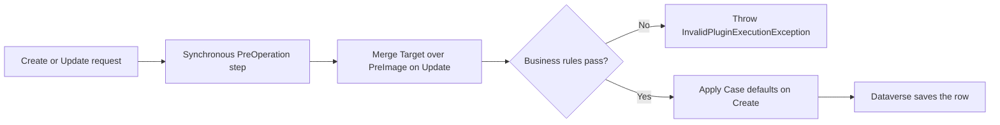

# PropertyCare CRM — Dataverse Validation Plugins

Server-side validation and data protection for property maintenance cases, tenancies, visits, and cost approvals in Microsoft Dataverse.

`CaseGuard` protects the context of a PropertyCare case and sets its initial response deadline. `RecordGuard` validates supporting records, including tenancy date overlaps. Both use early-bound entities and reject invalid requests with `InvalidPluginExecutionException`.

| Plugin class | Responsibility | Registration |
| --- | --- | --- |
| `Plugins.CaseGuard` | PropertyCare case rules and initial defaults | Case Create + Update |
| `Plugins.RecordGuard` | Tenancy, Visit, and Cost Approval rules | Create + Update for each table |

**Registration footprint:** 2 plugin types, 8 synchronous steps, and 4 pre-images. The procedure below assumes both types are compiled into one assembly.

> **Scope and evidence:** This README describes the supplied C# implementations. The registration settings are a reproducible configuration for that code, not an audit of a live environment. Earlier development notes report registration and some manual testing; the testing section distinguishes those reports from checks still required. The `pc_EscalateCase` Custom API implementation was not supplied.

## Contents

- [Architecture](#architecture)
- [Business rules](#business-rules)
- [Build prerequisites](#build-prerequisites)
- [XrmToolBox registration](#xrmtoolbox-registration)
- [Update filtering attributes](#update-filtering-attributes)
- [Pre-image configuration](#pre-image-configuration)
- [Deployment and updates](#deployment-and-updates)
- [Testing](#testing)
- [Troubleshooting](#troubleshooting)
- [Caveats and remaining work](#caveats-and-remaining-work)

## Architecture

The supplied classes inherit from `PluginBase` and override `ExecuteCdsPlugin(ILocalPluginContext)`. They obtain the execution context, current-user organization service, and, in `CaseGuard`, the tracing service through that context wrapper. The base-class implementation is a required project dependency; its internals were not supplied.

The `CrmEarlyBound` namespace provides `Incident`, `Contact`, `pc_Unit`, `pc_Tenancy`, `pc_Visit`, `pc_CostApproval`, and their choice enums.



`Target` is the incoming request, which can contain only a few columns on Update. Each plugin first copies the pre-image attributes, then overlays the target attributes. An explicit `null` in the target therefore clears the previous value and is validated as a clear, rather than being ignored.

`CaseGuard.Same` compares lookup IDs and logical table names, ignoring case in the logical name. `CaseGuard.Merge` also preserves the record ID. `RecordGuard` merges attributes separately for each supported table and uses `target.Id` to exclude the current tenancy from its overlap query.

All steps below use **PreOperation, stage 20**, so `CaseGuard` can write defaults directly into `Target` before persistence. Neither class calls `service.Update` on the current row. A synchronous failure cancels the request; PreOperation runs within the database transaction. See Microsoft's [exception handling guidance](https://learn.microsoft.com/en-us/power-apps/developer/data-platform/handle-exceptions).

## Business rules

### CaseGuard

The handler runs on the standard Case table, whose logical name is `incident`.

#### Classification and case context

| Rule | Implemented behavior |
| --- | --- |
| PropertyCare classification | On Update, the boolean result of `pc_IsPropertyCare == true` cannot change. Both enabling and disabling classification are blocked. `null` and `false` are treated equivalently. |
| Ordinary cases | After the classification check, the plugin returns when `pc_IsPropertyCare != true`; the remaining PropertyCare rules do not run. |
| Required fields | PropertyCare cases require a nonblank Title, Customer, Property, Unit, Tenancy, and a Category value. |
| Customer type | Customer must reference a Contact, rather than an Account. |
| Immutable context | On Update, Customer, Property, Unit, and Tenancy must match their previous lookup values. Title and Category are not made immutable. |
| Unit relationship | The selected Unit's `pc_property` must match the Case Property. |
| Tenancy relationship | The selected Tenancy's `pc_unit` must match the Case Unit, and its `pc_resident` must match the Case Customer. |

Relationship validation retrieves the Unit with `pc_property`, then the Tenancy with `pc_unit` and `pc_resident`. It does not validate tenancy dates or active status against the case date.

#### Response dates and initial defaults

| Rule | Implemented behavior |
| --- | --- |
| First Response On | When present, it must not be later than `DateTime.UtcNow`. An `Unspecified` value is treated as UTC before comparison. |
| Protected deadline | If the incoming target contains `pc_responseby`, the request is rejected on both Create and Update, including an explicit null or an unchanged value. |
| Response By calculation | On Create only, the plugin assigns `DateTime.UtcNow.AddHours(hours)` to the target. |
| Estimated Hours default | On Create only, a missing/null value is replaced with decimal `1m`. Existing values are retained; the code does not enforce a positive minimum. |

| Priority on Create | Response deadline |
| --- | --- |
| High | Current UTC time + 4 hours |
| Normal | Current UTC time + 24 hours |
| Low | Current UTC time + 72 hours |
| Missing/null | Uses Normal for the calculation: +24 hours |
| Other enum value | Rejected with `Invalid Case priority.` |

These are elapsed hours, including weekends and holidays. The deadline is based on plugin execution time, rather than `createdon`. Changing priority later does **not** recalculate it. The fallback used for deadline calculation does not itself write `prioritycode` into the target.

#### Escalation protection

- A new PropertyCare case cannot have `pc_Escalated == true` or a nonblank escalation reason.
- On Update, including either `pc_escalated` or `pc_escalationreason` triggers the escalation gate, even if the submitted value is unchanged.
- The plugin walks the entire `ParentContext` chain and requires an ancestor whose `MessageName` is exactly `pc_EscalateCase`.
- Within that permitted call chain, the merged case must be escalated and have a nonblank reason. Setting the flag back to false through that path is rejected.

This code protects the fields; it does not implement the Custom API, its authorization, a command-bar button, or notifications. A separate later request from a flow or client has no such parent API context and will be rejected when it includes these fields.

#### EGP currency

On Create, if `TransactionCurrencyId` is absent/null at this stage, the plugin queries `transactioncurrency` for `isocurrencycode = EGP`, selects at most one row, and writes its reference into the target. If no row is found, creation fails.

Whether supplied or defaulted, the currency must reference `transactioncurrency`, and its retrieved ISO code must equal `EGP`, ignoring case. On Update, a missing merged currency is rejected; it is not defaulted again. The implementation does not filter the currency query by active state or convert amounts.

### RecordGuard

The handler selects its validation branch using `context.PrimaryEntityName`. All three branches merge the Update pre-image with the incoming target before validation.

#### Tenancy

If both dates exist, the End Date must be **strictly after** the Start Date when compared using `.Date`. Same-day tenancies fail even when the end time is later.

If Unit, Start Date, and End Date all exist, a `QueryExpression` checks for an existing tenancy satisfying all of these conditions:

```text
existing.pc_unit      = proposed.pc_unit
existing.pc_startdate <= proposed.pc_enddate.Date
existing.pc_enddate   >= proposed.pc_startdate.Date
existing.pc_tenancyid != target.Id   // Update only
```

The query requests no business columns (`ColumnSet(false)`) and stops after one match (`TopCount = 1`). A match rejects the request.

The intervals are **inclusive**: for date-only tenancy data, an existing tenancy ending on June 10 conflicts with one starting on June 10. Starting on June 11 is allowed if there is no other overlap. There is no active/status filter, so inactive matching rows also count. Missing Unit or dates skip the overlap check; these fields are not made required by this code.

#### Visit

- When both timestamps exist, Scheduled End must be strictly later than Scheduled Start.
- When Visit Status is `pc_VisitStatus.Completed`, Outcome must contain non-whitespace text.
- The time-order check is skipped if either timestamp is missing. This plugin does not require both timestamps or prevent overlapping visits.

#### Cost Approval

- `Approved` and `Rejected` decisions require both Decided By and Decided On.
- `Rejected` also requires a nonblank Reason.
- Other decision values do not trigger these requirements.

The plugin does not populate the decision maker/date, verify the decision maker is the caller, restrict decision transitions, or validate amounts.

## Build prerequisites

Before registration, prepare:

1. The PropertyCare Dataverse schema, including all referenced columns, relationships, and choice values; the standard Case table must be available.
2. The supplied plugin classes, their `PluginBase`/`ILocalPluginContext` dependencies, and matching generated `CrmEarlyBound` types and enums.
3. A C# class-library project targeting a Dataverse-supported **.NET Framework** version, with the required SDK references, normally through `Microsoft.CrmSdk.CoreAssemblies`.
4. An EGP transaction currency and valid Contact → Tenancy → Unit → Property test records.
5. A deployment account permitted to register plugins and manage the solution. Runtime users also need the necessary row and column access.

Build the **Release** configuration. The assembly filename comes from the project: `Plugins.dll` is only an example, not a confirmed build output.

For the individual-DLL registration path below, sign the assembly and include generated early-bound source and base-class source in the same assembly where practical. A local reference to a separate `CrmEarlyBound.dll` does not upload that dependency. If separate runtime dependencies are required, use supported plugin-package deployment instead; do not register an early-bound library as a plugin or rely on ILMerge. SDK runtime assemblies are already provided by Dataverse. See [build and package constraints](https://learn.microsoft.com/en-us/power-apps/developer/data-platform/build-and-package).

> The project file, generated metadata, and compiled assembly were not supplied for this documentation review. No framework version, package version, output filename, or successful build is claimed here.

## XrmToolBox registration

### 1. Open the registration tool

1. Start XrmToolBox.
2. Open **Configuration → Tool Library**, find **Plugin Registration**, select it, and choose **Install** if needed.
3. Open **Plugin Registration** from the tools list and select or create the connection to the development environment. Confirm the environment URL before registering anything.

These navigation labels follow the [XrmToolBox first-steps guide](https://www.xrmtoolbox.com/documentation/for-users/first-steps-with-xrmtoolbox/). The community [Plugin Registration tool](https://github.com/imranakram/PluginRegistration) is an XrmToolBox adaptation of the classic registration tool; some labels vary between releases. The settings below identify the required registration values regardless of dialog layout.

### 2. Register the assembly once

1. Choose **Register → Register New Assembly** (or **New Assembly**).
2. Browse to the freshly built Release DLL using **…**.
3. Set **Isolation Mode = Sandbox** and **Location = Database**.
4. Ensure the assembly and both concrete plugin types are selected, then choose **Register Selected Plugins**.
5. Expand the assembly and confirm `Plugins.CaseGuard` and `Plugins.RecordGuard` appear.

Do not register `PluginBase`, entity classes, or SDK assemblies as additional handlers. Registering the DLL exposes the types; the steps below make them execute. Microsoft's [registration tutorial](https://learn.microsoft.com/en-us/power-apps/developer/data-platform/tutorial-write-plug-in#register-your-assembly) documents this assembly/step workflow.

### 3. Create exactly eight steps

Right-click the appropriate **plugin type**, choose **Register New Step**, enter one row from this table, then save. Repeat for all eight rows.

| # | Suggested step name | Event Handler | Message | Primary Entity | Stage | Mode | Order | Update filters | Pre-image |
| --- | --- | --- | --- | --- | --- | --- | --- | --- | --- |
| 1 | `PropertyCare.CaseGuard.Create` | `Plugins.CaseGuard` | `Create` | `incident` | PreOperation (20) | Synchronous | 10 | None | None |
| 2 | `PropertyCare.CaseGuard.Update` | `Plugins.CaseGuard` | `Update` | `incident` | PreOperation (20) | Synchronous | 10 | C1 | `PreImage` / C1 |
| 3 | `PropertyCare.RecordGuard.Tenancy.Create` | `Plugins.RecordGuard` | `Create` | `pc_tenancy` | PreOperation (20) | Synchronous | 10 | None | None |
| 4 | `PropertyCare.RecordGuard.Tenancy.Update` | `Plugins.RecordGuard` | `Update` | `pc_tenancy` | PreOperation (20) | Synchronous | 10 | T1 | `PreImage` / T1 |
| 5 | `PropertyCare.RecordGuard.Visit.Create` | `Plugins.RecordGuard` | `Create` | `pc_visit` | PreOperation (20) | Synchronous | 10 | None | None |
| 6 | `PropertyCare.RecordGuard.Visit.Update` | `Plugins.RecordGuard` | `Update` | `pc_visit` | PreOperation (20) | Synchronous | 10 | V1 | `PreImage` / V1 |
| 7 | `PropertyCare.RecordGuard.CostApproval.Create` | `Plugins.RecordGuard` | `Create` | `pc_costapproval` | PreOperation (20) | Synchronous | 10 | None | None |
| 8 | `PropertyCare.RecordGuard.CostApproval.Update` | `Plugins.RecordGuard` | `Update` | `pc_costapproval` | PreOperation (20) | Synchronous | 10 | A1 | `PreImage` / A1 |

Common settings for every step:

| Setting | Value |
| --- | --- |
| Run in User's Context | Calling User |
| Secondary Entity | Blank |
| Deployment | Server, if this option is shown |
| Unsecure / Secure Configuration | Blank; the supplied classes do not consume configuration strings |
| Enabled | Yes, after configuration is complete |

Execution order **10** is the baseline chosen for this guide, not a verified historical value. Coordinate distinct orders with other handlers on the same table/message/stage; ties do not establish a reliable sequence. If completing a multi-step registration in a shared environment, keep the new steps disabled until their images and filters are ready.

**Metadata check:** `RecordGuard` uses generated `EntityLogicalName` constants. Confirm `pc_visit` and `pc_costapproval`, and all generated-property column names below, against the generated classes' `AttributeLogicalName` attributes or Dataverse metadata. They follow the supplied naming convention, but the generated files were not included. `pc_tenancy`, `pc_tenancyid`, and columns used as string literals are directly evidenced in the supplied code. Always select logical names, not display labels.

Register these classes only for the listed Create/Update events. In particular, `CaseGuard` treats every message other than Create as an image-dependent path, and both handlers cast `Target` to `Entity`; Delete supplies an `EntityReference` instead.

## Update filtering attributes

In each **Update** step, open the **Filtering Attributes** selector and select its exact set below. Leave Create-step filters empty.

Filters are an **OR** over columns included in the request, not a check that their values changed. An empty Update filter executes on every update. Exclude the table's primary key. See [Microsoft's filtering guidance](https://learn.microsoft.com/en-us/power-apps/developer/data-platform/best-practices/business-logic/include-filtering-attributes-plugin-registration) and the [registration field definitions](https://learn.microsoft.com/en-us/power-apps/developer/data-platform/register-plug-in#general-configuration-information-fields).

### C1 — Case: 14 columns

```text
pc_ispropertycare,title,customerid,pc_property,pc_unit,pc_tenancy,pc_category,prioritycode,pc_firstresponseon,pc_responseby,pc_estimatedhours,pc_escalated,pc_escalationreason,transactioncurrencyid
```

This set covers the fields validated, protected, or defaulted by `CaseGuard`. It deliberately includes `prioritycode` and `pc_estimatedhours` so changes to those fields still revalidate the case; it does not make priority changes recalculate the deadline or add numeric validation to estimated hours.

Keep `pc_ispropertycare`, `pc_responseby`, `pc_escalated`, and `pc_escalationreason` in the filter. Omitting them would let a request changing only one of those protected fields avoid this handler.

### T1 — Tenancy: 3 columns

```text
pc_unit,pc_startdate,pc_enddate
```

### V1 — Visit: 4 columns

```text
pc_scheduledstart,pc_scheduledend,pc_visitstatus,pc_outcome
```

### A1 — Cost Approval: 4 columns

```text
pc_decision,pc_decidedby,pc_decidedon,pc_reason
```

Each can make an approved/rejected record invalid, including clearing a previously supplied decision maker, date, or reason.

Updates containing only unrelated columns do not trigger the corresponding step. Revalidating every update instead would require intentionally removing the filter and accepting the additional processing.

## Pre-image configuration

Create **one image under each Update step**, for four images total. No Create step needs an image, and no Post Image is used.

1. Right-click the Update **step**, then choose **Register New Image**.
2. Select **Pre Image** only.
3. Set **Name = PreImage** and **Entity Alias = PreImage**.
4. If shown, set **Message Property Name = Target**.
5. In **Parameters / Attributes**, clear **All Attributes** and select the set listed below.
6. Save/register the image and reopen its properties to verify the alias and columns.

| Parent Update step | Image type | Name | Entity Alias | Parameters / Attributes |
| --- | --- | --- | --- | --- |
| `PropertyCare.CaseGuard.Update` | Pre Image | `PreImage` | `PreImage` | All 14 C1 columns |
| `PropertyCare.RecordGuard.Tenancy.Update` | Pre Image | `PreImage` | `PreImage` | All 3 T1 columns |
| `PropertyCare.RecordGuard.Visit.Update` | Pre Image | `PreImage` | `PreImage` | All 4 V1 columns |
| `PropertyCare.RecordGuard.CostApproval.Update` | Pre Image | `PreImage` | `PreImage` | All 4 A1 columns |

The runtime collection key is the **Entity Alias**. Every supplied Update branch reads `context.PreEntityImages["PreImage"]` directly, so preserve this spelling and casing. The image belongs to its step; creating it under one step does not configure another. See Microsoft's [image-registration walkthrough](https://learn.microsoft.com/en-us/power-apps/developer/data-platform/tutorial-update-plug-in#add-an-image).

For C1, the 14-column image is an intentional small superset. `prioritycode`, `pc_responseby`, and `pc_estimatedhours` are not required from the previous row by the current Update logic; including them keeps C1 identical for filters and images. The remaining columns support merged-state validation. Filters decide **when to run**; images provide **previous values**. They serve different purposes even when their lists match.

## Deployment and updates

### Initial solution packaging

In the development environment, open the unmanaged **PropertyCare CRM** solution in Power Apps. Add the registered assembly through **Add existing → More → Developer → Plug-in assembly**, then add each of the eight registered plugin steps through the corresponding **Plug-in step** option. Adding the assembly alone does not add its steps. Include the required table/column/choice dependencies and verify all four step images in the exported solution. See [adding registered components to a solution](https://learn.microsoft.com/en-us/power-apps/developer/data-platform/register-plug-in#add-your-assembly-to-a-solution).

Publish the relevant schema customizations, export the versioned solution, and import it into a test environment. Use managed solutions for controlled downstream releases when that is the project's ALM approach. Configure EGP currency and test data separately: solution components are not a substitute for those environment records.

### Updating code in development

1. Change the source and rebuild Release using the intended assembly identity and signing key.
2. Select the **existing assembly** in Plugin Registration and choose **Update**.
3. Browse to the rebuilt DLL, select the assembly/plugin types, and choose **Update Selected Plugins**.
4. Refresh and confirm the expected version and both types are present.
5. Edit existing step filters and image columns if the code now reads or protects additional fields.
6. Check that there are still eight intended steps and four images, then rerun the affected regression scenarios.
7. Update the solution version, export, import into test, and validate before promoting the release.

Updating the assembly does not automatically create new steps or repair filter/image lists. Preserve existing registrations for routine code changes. Do not unregister and recreate the assembly as an update procedure: that removes its child registrations. See [Microsoft's assembly-update procedure](https://learn.microsoft.com/en-us/power-apps/developer/data-platform/tutorial-update-plug-in#update-the-plug-in-assembly-registration).

For managed-solution imports, changing only the assembly **build/revision** supports an in-place upgrade; changing **major/minor** creates a different assembly identity and requires deliberate step reassociation before export. Keep assembly version and solution version distinct. See [assembly versioning](https://learn.microsoft.com/en-us/power-apps/developer/data-platform/register-plug-in#assembly-versioning).

Retain the previous source, DLL, solution export, and registration settings for recovery. Test the recovery procedure for the deployment method in use; re-uploading a DLL alone does not revert schema or registration changes.

## Testing

### Reported development status

The earlier project notes report the following. These are conversation-level reports, not newly executed tests or a complete evidence log.

| Area | Reported status | Remaining verification |
| --- | --- | --- |
| CaseGuard | Create/Update validation, relationship checks, protected context, and initial response deadline were reported tested | Capture per-rule evidence and rerun after deployment |
| RecordGuard registration | Six steps and three images were reported registered | Verify all eight project steps/four images against this guide |
| Tenancy | Date order, overlap rejection, and separated periods were reported tested | Confirm Update overlap rejection and self-exclusion |
| Visit | Time-order validation was reported successful | Prove Completed + missing Outcome reaches and is rejected by the plugin |
| Cost Approval | Form validation blocked incomplete decisions | Test server behavior through SDK/Web API |
| Escalate Case API | Identified as future work | Implement API and authorization before testing its allowed path |

No Dataverse connection, project build, or live test execution was performed while preparing this README.

### Test setup and method

Use a development/test environment with an EGP currency, another currency, a Contact, an Account, two Properties, Units linked to those Properties, and Tenancies linked to the relevant Unit and resident. Keep unrelated data valid so the intended validation is the first failure.

Run negative cases through a Dataverse SDK client or Web API as well as the model-driven form. If a form blocks submission first, record **UI blocked — plugin not exercised**. For sparse Update tests, submit only the changed attribute; for clear tests, submit an explicit null. Use actual environment choice values from the generated enums/metadata.

For every rejected save, retrieve the row and confirm it is unchanged. For accepted saves, retrieve the stored values rather than relying only on a success notification. Record environment, assembly version, user, request fields, expected/actual result, and any trace/correlation identifier.

### CaseGuard acceptance matrix

| Scenario | Expected result from the supplied code |
| --- | --- |
| Valid PropertyCare Create without deadline, hours, or currency | Save; deadline assigned, hours default to 1, EGP selected if currency is still absent at execution |
| High / Normal / Low Create | Deadline approximately execution UTC +4 / +24 / +72 hours |
| Omit priority on Create | Deadline uses +24 hours |
| Missing/blank required value; Account as Customer | Reject |
| Unit belongs to another Property | Reject |
| Tenancy has another Unit or resident | Reject |
| Change PropertyCare classification in either direction | Reject |
| Change Customer, Property, Unit, or Tenancy on an existing PropertyCare case | Reject |
| Send `pc_responseby`, even unchanged or null, on Create/Update | Reject |
| Future First Response On | Reject; use a clear future offset to avoid timing ambiguity |
| Past First Response On, or clear it | Allow if other rules pass |
| Non-EGP currency; clear currency on Update | Reject |
| No EGP row and no currency on Create | Reject; test in a controlled environment without disrupting shared currency data |
| Create escalated or with a nonblank escalation reason | Reject |
| Direct Update containing either escalation field | Reject, including unchanged values |
| API ancestor with escalated=true and nonblank reason | Allow if all other rules pass; pending API implementation |
| API ancestor with escalated=false or missing/blank reason | Reject; pending API implementation |
| Update priority only | Revalidate; retain the original deadline |
| Ordinary case remains non-PropertyCare | Skip the PropertyCare-specific rules |

### RecordGuard acceptance matrix

| Area / scenario | Expected result from the supplied code |
| --- | --- |
| Tenancy: End Date before or on Start Date | Reject on Create and Update when both dates are present |
| Tenancy: same Unit with an intersecting interval | Reject |
| Tenancy: shared boundary date | Reject for date-only data |
| Tenancy: next day after an existing End Date | Allow if no other interval overlaps |
| Tenancy: same dates on another Unit | Allow |
| Tenancy: sparse date/Unit Update causing overlap | Reject using merged values; key pending regression |
| Tenancy: update an existing interval without introducing a conflict | Allow; the current row must not match itself |
| Tenancy: inactive matching record exists | Reject; no state filter exists |
| Tenancy: missing Unit/Start/End | Overlap validation skips; other platform rules may reject |
| Visit: equal/reversed timestamps | Reject when both timestamps exist |
| Visit: Completed without Outcome, or clear Outcome on a completed visit | Reject, including sparse Updates |
| Visit: Completed with nonblank Outcome and valid times | Allow |
| Cost Approval: Approved/Rejected without Decided By | Reject |
| Cost Approval: Approved/Rejected without Decided On | Reject |
| Cost Approval: Rejected without a nonblank Reason | Reject |
| Cost Approval: clear required decision metadata on an already decided row | Reject using merged state |
| Cost Approval: Approved with metadata / Rejected with metadata and reason | Allow |

“Allow” means these handlers do not reject that scenario; security, required columns, other plugins, and platform rules may still prevent persistence.

### Registration regression checks

- Send a one-field Update for each protected field and verify the relevant step runs.
- Send a same-value filtered field: the step should still run.
- Send only an unrelated field: a filtered Update step should not run.
- Verify sparse Updates retain the prior values through the image and explicit clears do not.
- Check for duplicate steps after every assembly update or solution import.
- Test using the intended application-user/security roles, including a caller unable to read an existing tenancy that should conflict.
- Test two simultaneous conflicting tenancy requests; do not assume the query guarantees exclusive occupancy under concurrency.

## Troubleshooting

| Symptom | Check |
| --- | --- |
| Missing-key/image error on Update | The image is attached to that exact step and its Entity Alias is `PreImage` |
| Valid Update reports missing fields | The pre-image contains the complete required set and generated logical names match metadata |
| No validation after a relevant change | Step enabled, correct environment/type/entity/message, and changed field present in the filter |
| Expected-hours/deadline default is absent | Create step registered as synchronous PreOperation; case classified as PropertyCare |
| `Response deadline cannot be edited.` on Create | Client/flow/another handler submitted `pc_responseby`; omit it so CaseGuard can assign it |
| `Use the Escalate Case API.` | This is a direct update or a separate later request; it has no matching API ancestor |
| `Only EGP currency is supported.` | Inspect the currency actually supplied/defaulted before this stage |
| Lookup retrieval/permission failure | Caller access to Unit, Tenancy, currency, and required columns; inspect `PluginBase` service construction |
| Overlap unexpectedly accepted | Missing dates/Unit, incorrect filter/image, caller cannot see the conflicting row, or concurrent requests |
| Unexpected overlap rejection | Inclusive endpoints, inactive rows, and stored date/time behavior |
| Behavior repeats or old code appears to run | Duplicate registrations, outdated assembly, or steps still bound to another assembly version |

Temporarily enable plugin trace logging for troubleshooting and inspect **Plug-in Trace Log**, or use a trace-viewing tool. `CaseGuard` explicitly writes `CaseGuard completed successfully.` only after its full PropertyCare path succeeds. Ordinary cases return earlier. `RecordGuard` has no explicit trace calls in the supplied code; any additional tracing depends on `PluginBase`.

Use **All** only while diagnosing; reduce/disable logging afterwards to limit storage. See [Microsoft's tracing guidance](https://learn.microsoft.com/en-us/power-apps/developer/data-platform/logging-tracing).

## Caveats and remaining work

1. **Escalation authorization remains to be implemented.** Matching an ancestor message name is a workflow gate, not a permission check. The Custom API must authorize its caller and perform the update within that execution chain. Its definition, parameters, implementation, and registration are outside these eight steps.
2. **Overlap detection depends on read visibility.** `CurrentUserService` queries the records visible to its effective user. The proposed Calling User configuration needs access to all potentially conflicting tenancies, including required columns. Decide the security/service-identity design explicitly if cross-owner/business-unit visibility is restricted.
3. **The overlap query is not a concurrency guarantee.** Two requests can both query before either conflicting row is visible. Production exclusivity needs an additional serialization/locking design and concurrent-request tests. Row-level optimistic concurrency alone does not protect two separate new tenancy rows.
4. **Date semantics must match the schema.** Tenancy comparisons truncate proposed values to `.Date`, but the query uses stored existing values directly. Use consistent date-only tenancy data and verify the actual Dataverse date behaviors. Visit timestamps are compared directly; First Response On explicitly normalizes UTC. Test user time zones and daylight-saving boundaries where relevant.
5. **These handlers do not provide every domain constraint.** RecordGuard does not make missing tenancy dates/Unit or visit times required. CaseGuard does not validate tenancy effective dates, freeze First Response On, enforce positive estimated hours, or implement business-calendar SLAs. Cost Approval has no amount/authority checks.
6. **Validation is event-scoped.** Unrelated-column Updates are filtered out. Editing a Unit's Property or a Tenancy's resident later does not proactively revalidate all linked cases. Other pipeline handlers can also change values; coordinate execution order and shared ownership of protected fields.
7. **Registration is part of the implementation.** Missing pre-images, unsupported messages, stale generated enums/columns, and missing runtime dependencies can fail before a friendly business-rule error. Keep metadata, code, filters, and images aligned in every release.
8. **Complete server-level regression evidence before release.** Finish the pending Update-overlap test, test validations that the form previously intercepted, implement and test the escalation API, and validate a solution import in a separate environment.

The implementation provides a focused validation layer. Deployment readiness depends on the schema, registration, runtime permissions, remaining API work, and the test evidence described above.
